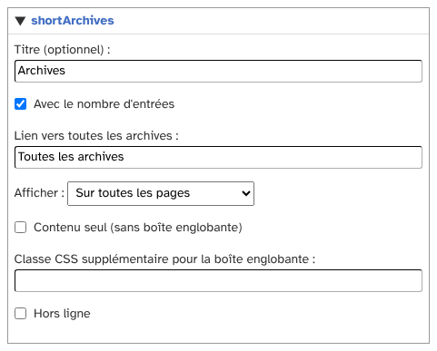
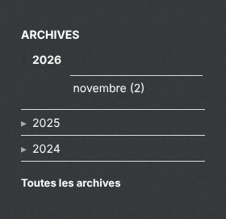
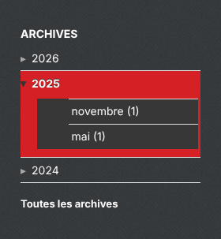

# shortArchives : guide d'utilisation

shortArchives ajoute un widget qui liste les archives de votre blog, année par année, dans un menu accordéon. Un clic sur une année déplie ses mois.

Le plugin n'a pas de page d'administration. Tout se règle dans le widget.

## Sommaire

* [Ajouter le widget](#ajouter-le-widget)
* [Les réglages du widget](#les-réglages-du-widget)
* [Utiliser le menu accordéon](#utiliser-le-menu-accordéon)
* [Bon à savoir](#bon-à-savoir)

## Ajouter le widget

1. Allez dans « Widgets ».
2. Dans la liste des widgets disponibles, choisissez « shortArchives », puis ajoutez-le à la zone de votre choix.
3. Ouvrez le widget pour le régler, puis enregistrez.

## Les réglages du widget

* « Titre (optionnel) » : le titre du widget, « Archives » par défaut.
* « Avec le nombre d'entrées » : affiche, après chaque mois, le nombre de billets publiés ce mois-là.
* « Lien vers toutes les archives » : ajoute sous le menu un lien vers la page de toutes les archives, avec le texte que vous saisissez. Laissez le champ vide pour ne pas afficher ce lien.
* « Afficher » : toutes les pages, accueil seulement, ou sauf l'accueil.
* Les réglages habituels des widgets : contenu seul, classe CSS, hors ligne.

## Utiliser le menu accordéon

Le menu liste les années, de la plus récente à la plus ancienne. Une seule année est ouverte à la fois :

* sur la plupart des pages, c'est l'année la plus récente ;
* quand le visiteur consulte une archive, c'est l'année de cette archive.

Pour changer d'année, le visiteur clique sur l'année voulue. Elle s'ouvre, et la précédente se referme. Un clic sur l'année ouverte la referme.

Chaque mois est un lien vers la page d'archive de ce mois, qui affiche les billets correspondants.

## Bon à savoir

* Le widget n'apparaît que si le blog a au moins un billet publié.
* Le menu a besoin de JavaScript pour s'ouvrir et se fermer. Sans JavaScript, tous les mois restent visibles.
* Dans nos essais, le choix « En page d'accueil seulement » n'a pas masqué le widget sur les autres pages.
* Le nom du widget reste « shortArchives » dans l'administration, y compris en français.
